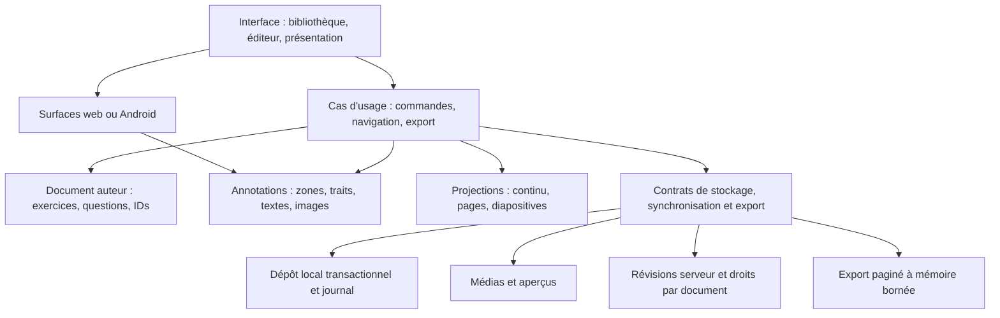

# Architecture de Zone Exercice : revue et migration

25 octobre 2026. Ce document distingue les changements livrés, les conclusions de la revue et la migration encore nécessaire. Une compilation réussie ne certifie pas une capacité comparable à Word, Photoshop ou Duolingo.

## Décision produit

Construire un atelier pédagogique léger : documents structurés, encre manipulable, présentation claire, progression pédagogique et sauvegarde fiable. Les références citées définissent un niveau d'exigence ; elles ne signifient pas que leurs catalogues de fonctions doivent être copiés.

La première exigence est la conservation du travail : une réponse ne doit pas passer à une autre sous-question, une importation ne doit pas effacer silencieusement le contenu et un changement de vue ne doit pas modifier le document.

## Réunion de revue d'ingénierie

Trois agents ont examiné des axes différents, puis leurs propositions ont été confrontées et intégrées avec une revue supplémentaire du socle d'encre. Il s'agit d'une revue entre agents logiciels, pas d'une réunion avec des ingénieurs humains externes.

| Sujet | Proposition et objection examinée | Décision retenue |
| --- | --- | --- |
| Organisation générale | Une réécriture du rendu ou des microservices multiplieraient les migrations sans résoudre les pertes locales | Monolithe modulaire TypeScript et migration avec tests de non-régression |
| Questions par page | Feuilles seules : perte d'un énoncé parent autonome ; tous les conteneurs : pages vides | Une page par nœud significatif ; parent visible = introduction ; conteneur silencieux = contexte ; chaque sous-question significative a sa page |
| Présentation | Flèches locales et globales pouvaient avancer deux fois | Étapes locales en priorité, puis navigation globale à leur limite ; boutons et compteur explicites |
| Impression progressive | Révéler les étapes pouvait être confondu avec ouvrir les corrigés | Tout l'énoncé est imprimé ; les corrigés fermés restent fermés |
| Identités | Des UUID différents créés sur chaque appareil ne permettraient pas de reconnaître une ancienne question | Conserver les IDs auteurs ; correspondance legacy unique ; copie de récupération si ambiguë |
| Synchronisation | L'absence cloud ne signifie pas suppression volontaire d'une fiche privée | Ne pas supprimer les fiches exclusivement locales ; futures suppressions avec traces explicites et droits |
| Encre et React | Les refs mutables partageaient les points des données React | Modèle d'encre indépendant, caches DOM séparés, copies aux frontières et réconciliation du geste concurrent |
| Éviction des surfaces | Démonter brutalement un canvas peut perdre historique ou brouillon | Reporter l'éviction jusqu'à externalisation de ces états ; ne pas présenter le masquage comme de la virtualisation |
| Stockage | Migration immédiate sans copie vérifiée : risque de données irrécupérables | Réparer les échecs actuels ; migration IndexedDB reprenable et sauvegarde brute conservée |
| Poids initial | Alléger en supprimant la validation dégraderait la fiabilité | Validation conservée aux frontières, chargée à la demande ; galerie et fusion sans Zod au démarrage |

Notes détaillées : [présentation](REVIEW_PRESENTATION.md), [données](AUDIT_DONNEES_SYNC.md), [plateforme](REVIEW_PLATFORM.md).

## Architecture cible complète



### Document et annotations

Le document auteur doit contenir une version de schéma et des identités stables pour documents, exercices, questions et zones. La hiérarchie définit le contexte et la numérotation ; elle ne définit pas à elle seule les pages physiques.

Les annotations doivent devenir un document séparé, indexé par ID de zone et propriétaire. Les coordonnées emploient un repère documentaire stable indépendant de la largeur écran. Web, Android et export utilisent la même transformation. Une suppression auteur conserve les annotations orphelines récupérables.

Les médias doivent être stockés comme blobs référencés par identité et empreinte, avec dimensions et type validés. Les grandes chaînes base64 ne doivent pas être recopiées dans chaque snapshot de bibliothèque.

### Commandes, sauvegarde et historique

Toute modification logique passe par une commande : éditer un énoncé, déplacer une question, ajouter un trait, transformer une sélection ou modifier un fond. Une commande possède une cible stable et une révision attendue. Elle est testable indépendamment de React. L'historique cible couvre toutes les transformations et éditions de texte.

La sauvegarde confirme une écriture durable avant d'annoncer un état enregistré. Brouillons et gestes ont un cycle de vie explicite. Une mise à jour distante ne peut pas remplacer une annotation uniquement parce qu'elle occupe le même index.

### Projections et pagination

Le plan de pages logiques dérive du document. Les chemins conservent les commandes rétrocompatibles ; les IDs sont les références durables. Un parent visible produit une introduction et son contexte est rappelé sur les sous-questions. Dix parents visibles et vingt feuilles produisent ainsi trente pages logiques. Les conteneurs silencieux ne consomment pas de page.

La pagination physique est distincte : mesurer formules, images, corrigés et zones après composition ; fragmenter les zones trop hautes ; conserver l'énoncé avec le début de sa réponse. « Une question par page » fait démarrer chaque unité sur une nouvelle page ; un contenu arbitrairement long peut encore nécessiter plusieurs feuilles.

Le diaporama sélectionne une page logique sans copier ses questions. L'impression parcourt toutes les pages. Les changements de vue préservent contexte, annotations et brouillons.

### Stockage, cloud et sécurité

Un dépôt local versionné doit exposer lecture, écriture transactionnelle, statut durable et récupération. La migration vers IndexedDB doit reprendre après interruption, vérifier les documents écrits et conserver la source avant activation définitive.

Le cloud cible échange des révisions par document avec contrôle de concurrence, identités et autorisations. Une suppression exige une trace explicite. Le snapshot global et le mot de passe partagé actuels ne fournissent pas cette architecture multiutilisateur.

Imports, médias, formules et réponses réseau sont des entrées à valider. KaTeX n'accorde plus une confiance universelle aux commandes HTML/URL : seuls les liens aux protocoles autorisés sont acceptés, conformément à son [contrat de confiance](https://katex.org/docs/options.html). Cette règle ne certifie pas tous les comportements du moteur MathJax distant.

### Plateforme et performances

Le client de base démarre sans compilateur CSS réseau. Le hors connexion ne promet que les ressources effectivement installées. Le cache d'une page ouverte reste cohérent avec ses modules.

Surfaces actives, pages voisines et miniatures nécessitent des caches bornés. L'export doit traiter des lots et libérer ses surfaces. Une surface AndroidX Ink native peut être prototypée ultérieurement ; aucune latence physique n'est déduite des tests web.

## Réarchitecture effectivement livrée

| Frontière | Implémentation |
| --- | --- |
| Modèle d'encre | `domain/ink.ts` sans types DOM ; cache image dans le type de rendu navigateur |
| Snapshots d'encre | `domain/inkDocument.ts` : points copiés, caches exclus, réconciliation des gestes et identité unique des brouillons |
| Commandes documentaires | `domain/worksheetCommands.ts` : chemins contrôlés, fond récursif, fusion de titres vides sans suppression des réponses |
| Adaptateur React | `features/workspace/useWorksheetCommands.ts`, utilisé par App |
| Plan de pages | `utils/questionLayout.ts` : fonctions pures, ancêtres, chemins et IDs auteurs uniques |
| Présentation | `features/presentation/` : boutons, compteur, plein écran, clavier et page active |
| Impression | `features/printing/useWorksheetPrint.ts` et cycle commun `utils/worksheetPrint.ts` |
| Navigateur | `platform/useScreenWakeLock.ts` : reprise après libération et nettoyage d'une requête tardive |
| Fusion cloud | `domain/worksheetSync.ts`, pur et sans Zod au démarrage |
| Schémas et imports | `domain/worksheetSchema.ts` et `utils/worksheetImport.ts`, différés côté client ; serveur validé immédiatement |
| Plateforme locale | Tailwind/PostCSS, `build/offlineShell.ts`, manifeste et service worker versionnés |
| Régression | `npm test`, `test:canvas`, `test:presentation`, `test:offline` |

App passe de 809 lignes à environ 620 pendant cette tranche et conserve de l'orchestration historique. Les composants canvas restent importants. La migration doit continuer vers un moteur, des outils et un historique indépendants. Les changements livrés dépassent le déplacement de fichiers : les frontières de mutation, pagination et validation ont été modifiées et testées.

## Résultats vérifiés

- **33 tests unitaires** : plan récursif, IDs, Beamer, commandes immuables, encre, confiance mathématique, imports, récupération, synchronisation et persistance simulée.
- **Présentation Edge** : une page visible, sous-question profonde autonome, progression locale puis globale ; cinq unités courtes donnent cinq pages PDF ; contexte complet ; corrigés fermés non révélés ; retour à la page sélectionnée après impression.
- **Canvas Edge** : vingt zones, cinq réglures, image hors écran, deux impressions sans mutation, pointeurs concurrents, point final, stylet/tactile, rafraîchissement externe d'une zone montée, geste concurrent et brouillon texte préservés.
- **Hors connexion en production** : profil neuf, CDN bloqués, installation, fermeture puis redémarrage sans réseau ; CSS et module différé disponibles, API hors cache.
- **Construction** : TypeScript et Vite passent. Le bundle initial est passé d'environ 852 Ko à environ 752 Ko après séparation des validations ; schémas dans un module différé d'environ 98 Ko. Le code exécuté au démarrage diminue, pas le poids total installé.
- **Contrôle visuel** : pages PDF rendues avec Poppler et diaporama inspectés.

Ces essais portent sur des documents synthétiques. Cloud Redis réel, transitions de session avec réseau différé dans React, imprimante physique, compilation Android et latence S-Pen restent hors validation.

## Travaux encore nécessaires

| Priorité | Migration | Critère de fin |
| --- | --- | --- |
| P1 | Stockage transactionnel et récupération de JSON local corrompu | Coupure pendant migration puis reprise sans perte ; source exportable avant remplacement |
| P1 | Document auteur séparé des annotations, IDs de zones durables | Réordonner, modifier ou supprimer un énoncé conserve les annotations récupérables |
| P1 | Repère d'encre stable et historique complet | Rotation, largeur et impression conservent géométrie ; undo/redo de toutes opérations |
| P1 | Zones/corrigés longs et export borné en mémoire | Cent questions sans troncature ni pic bitmap non borné ; annulation propre |
| P1 avant service public | Comptes, droits par document, concurrence serveur et limites de requêtes | Tests d'isolement entre utilisateurs et de deux sources simultanées |
| P1 avant distribution | Dépendances et signature Android | Exposition des vulnérabilités déterminée ; signature et navigation WebView validées sur appareil |
| P2 | Caches de surfaces et miniatures | Cent fiches et cent questions mesurées sur tablette ; aucun brouillon perdu à l'éviction |
| P2 | Moteurs et polices entièrement locaux | Matrice des formules/polices promises validée avec tous domaines externes bloqués |
| P2 | Progression pédagogique et accessibilité | Objectifs d'apprentissage et essais utilisateurs ; clavier, lecteur d'écran et tactile vérifiés |

Les budgets à définir et mesurer incluent nombre de surfaces actives, plafond mémoire d'export, temps d'ouverture et délai d'encre sur matériel cible. Ils ne sont pas des résultats de benchmark acquis.

L'audit des dépendances rapporte un groupe de vulnérabilités haut et plusieurs modérés. Les chaînes et leur exposition possible figurent dans la [revue plateforme](REVIEW_PLATFORM.md). Aucun correctif forcé, déploiement, envoi de données utilisateur ou remplacement automatique des clés de signature n'a été effectué.

## Reproduire la validation

```powershell
npm ci
npm test
npm run build
```

Avec Vite lancé et Playwright disponible : `npm run test:canvas` et `npm run test:presentation`. Après build et preview sur 4173 : `npm run test:offline`. Le [README](../README.md) précise les outils facultatifs et variables.

La cible complète est définie et plusieurs frontières importantes sont implémentées. Les migrations ci-dessus restent nécessaires avant de présenter le produit comme une application prête pour un large public.
